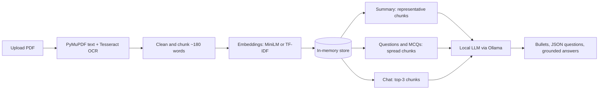

<div align="center">

# 📄 PDFSage

**A personal NLP project: an intelligent PDF assistant designed to run locally on your own computer.**

Upload a PDF and get a summary, study questions, interactive MCQs and a chat that answers from the document. No cloud, no API key.


</div>

---

## Table of Contents
- [Features](#-features)
- [Screenshots](#-screenshots)
- [How it works](#-how-it-works)
- [Tech stack](#-tech-stack)
- [Getting started](#-getting-started)
- [Use it from your phone](#-use-it-from-your-phone)
- [Configuration](#-configuration)
- [REST API](#-rest-api)
- [Project structure](#-project-structure)
- [Testing](#-testing)
- [Security](#-security)
- [Advantages and limitations](#-advantages-and-limitations)
- [Troubleshooting](#-troubleshooting)
- [Roadmap](#-roadmap)

## ✨ Features

| Feature | What it does |
|---|---|
| 📝 **Summary** | A 5-7 bullet summary built from the most representative parts of the PDF |
| ❓ **Study questions** | 1-12 questions generated from passages spread across the document |
| ✅ **MCQs** | 1-8 multiple-choice questions with four options and instant right/wrong feedback |
| 💬 **Chat with the PDF** | Retrieval-augmented answers (RAG) that show the source passages |
| 🔍 **OCR** | Scanned, image-only pages are read with PyMuPDF + Tesseract |
| 🔒 **Local and private** | A small LLM (about 3B parameters) runs through Ollama on your PC |
| 🛡️ **Secure by default** | Localhost only; token login for phones; CSRF, Host and upload-size protection |

## ⚙️ How it works



1. **Ingest:** the PDF is validated, text is extracted (OCR for pages without text), cleaned and split into overlapping sentence-aware chunks.
2. **Index:** each chunk is embedded (all-MiniLM-L6-v2, with an automatic TF-IDF fallback) and kept in memory.
3. **Generate:** the summary uses the chunks closest to the document centroid; questions and MCQs use chunks sampled evenly across the text and ask the LLM for JSON that is validated and retried once.
4. **Chat (RAG):** the question is embedded, the top-3 chunks are retrieved, and the LLM must answer only from them; the sources are shown.

## 🧰 Tech stack

| Layer | Technology |
|---|---|
| Backend | Python 3.10+, Flask |
| PDF and OCR | PyMuPDF, Tesseract-OCR |
| Embeddings | sentence-transformers (all-MiniLM-L6-v2), scikit-learn TF-IDF fallback |
| Language model | [Ollama](https://ollama.com) with `qwen2.5:3b` (default), `qwen3:4b` or `llama3.2:3b` |
| Frontend | HTML, CSS, vanilla JavaScript (no external libraries) |
| Quality | pytest, Bandit, pip-audit |

## 🚀 Getting started

### Prerequisites
- **Python 3.10+**
- **[Ollama](https://ollama.com/download)** installed and running
- **Tesseract-OCR** (only needed for scanned PDFs)
  - Windows: [UB-Mannheim installer](https://github.com/UB-Mannheim/tesseract/wiki), tick *Add to PATH*
  - Ubuntu/Debian: `sudo apt install tesseract-ocr`
  - macOS: `brew install tesseract`
- About 4 GB of free RAM for a 3B model (GPU optional)

### Install
```bash
git clone https://github.com/<your-username>/PDFSage.git
cd PDFSage

# 1. Download a small local model
ollama pull qwen2.5:3b

# 2. Create a virtual environment and install packages
python -m venv .venv
source .venv/bin/activate        # Windows: .venv\Scripts\activate
pip install -r requirements.txt
```

### Run
```bash
python app.py
```
Open **http://127.0.0.1:5000**, upload a PDF, wait for the statistics to appear, then use the Summary, Questions, MCQs and Chat tabs.

> The first run downloads the embedding model (about 90 MB). If it cannot be downloaded, PDFSage falls back to TF-IDF automatically (`PDFSAGE_EMBEDDER=tfidf` forces this).

## 📱 Use it from your phone

By default only your PC can open the app. To use a phone on the same Wi-Fi, set a secret token and your PC's LAN IP, then start Flask on all interfaces.

```bash
# Windows (cmd)
set PDFSAGE_TOKEN=a-long-random-secret
set PDFSAGE_ALLOWED_HOSTS=192.168.1.20

# Linux / macOS
export PDFSAGE_TOKEN=a-long-random-secret
export PDFSAGE_ALLOWED_HOSTS=192.168.1.20

flask --app app run --host 0.0.0.0 --port 5000
```
On the phone open `http://192.168.1.20:5000/?token=a-long-random-secret` once; a cookie keeps you signed in. The model still runs on the PC. Use **trusted Wi-Fi only** (plain HTTP). Allow Python through the firewall if the page does not load.

## 🔧 Configuration

| Variable | Default | Meaning |
|---|---|---|
| `OLLAMA_HOST` | `http://localhost:11434` | Where Ollama runs |
| `OLLAMA_MODEL` | `qwen2.5:3b` | Default model (also selectable in the UI) |
| `PDFSAGE_EMBEDDER` | `auto` | `tfidf` skips the embedding-model download |
| `PDFSAGE_TOKEN` | *(empty)* | Secret needed by any non-local device |
| `PDFSAGE_ALLOWED_HOSTS` | *(empty)* | Extra allowed host names or IPs |
| `PDFSAGE_MAX_MB` | `25` | Maximum upload size |
| `PDFSAGE_MAX_PAGES` | `100` | Maximum pages per PDF |

## 🔌 REST API

| Endpoint | Method | Body | Returns |
|---|---|---|---|
| `/api/status` | GET | - | Ollama status, models, loaded document info |
| `/api/model` | POST | `{"model": "qwen2.5:3b"}` | Selected model |
| `/api/upload` | POST | multipart `file` (PDF) | name, pages, ocr_pages, words, chunks, embedder |
| `/api/summary` | POST | `{}` | `summary` |
| `/api/questions` | POST | `{"n": 6}` (1-12) | `questions[]` |
| `/api/mcqs` | POST | `{"n": 4}` (1-8) | `mcqs[]` with `question`, `options[4]`, `answer` |
| `/api/chat` | POST | `{"question": "..."}` | `answer`, `sources[]` |

Errors return `{"error": "..."}` with 400, 401/403, 409 (no PDF loaded), 413, 422, 429 (model busy) or 503 (Ollama problem).

## 🗂 Project structure

```text
PDFSage/
├── app.py                  Flask app, security guard, REST API
├── backend/
│   ├── pdf_loader.py       PyMuPDF text extraction + OCR
│   ├── chunker.py          Sentence-aware chunking
│   ├── retriever.py        Embeddings and semantic search
│   ├── llm.py              Ollama client
│   └── features.py         Summary, questions, MCQs, RAG answers
├── templates/index.html    Page
├── static/                 app.js, style.css
├── tests/                  test_all.py, test_security.py, pentest.py
├── docs/                   Design report, security report, detailed report, images
├── requirements.txt
└── requirements-dev.txt
```

## 🧪 Testing

```bash
pip install -r requirements-dev.txt
python -m pytest -q            # 11 tests: OCR, chunking, retrieval, features, Ollama client, API, security
python tests/pentest.py check  # 16 scripted attack checks
bandit -r app.py backend       # static analysis
```
The Ollama client is tested against a mock server, so the tests do not need a model installed.

## 🛡 Security

A security assessment of the project found **14 weaknesses (5 High)** in its first version: no authentication, CSRF and DNS rebinding, missing size and page limits, shared state, unvalidated input, leaked errors, missing headers and unfenced prompt text. All were fixed and the same 16 checks now find none.

Controls: localhost-only default, token and HttpOnly cookie for remote devices, Host and Origin checks, 25 MB / 100-page / 600-chunk limits, input validation, Content-Security-Policy and other headers, document text fenced as untrusted data, and a single-job lock.

**Residual risks:** plain HTTP on the LAN, prompt injection is reduced but not eliminated, PDF parsing uses native code, and Ollama must never be exposed beyond your PC. Run `pip install -U -r requirements.txt` to get patched dependency versions. Details are in `docs/PDFSage_Security_Report.pdf`.

## ⚖️ Advantages and limitations

**Advantages:** fully private and free; works offline; four study tools in one upload; grounded answers with sources; OCR for scans; robust handling of weak model output; modular and tested; usable from a phone.

**Limitations:**
- A small 3B model can miss details and make mistakes, so verify important facts.
- Speed depends on your hardware; CPU-only PCs are slower.
- Only 3-6 chunks fit in each prompt, so long PDFs are summarised from representative parts.
- Text only: figures, charts, equations and table structure are not understood.
- OCR is English-only by default; one document at a time; nothing is saved between sessions.
- Output quality has not been benchmarked with real models yet.

For additional implementation details, see `docs/PDFSage_Detailed_Report.docx` if that file is included in your local project.

## 🩺 Troubleshooting

| Problem | Fix |
|---|---|
| "Ollama offline" | Start Ollama (desktop app or `ollama serve`) and refresh |
| Model not found | `ollama pull <model>` for the model chosen in the dropdown |
| "OCR unavailable" | Install Tesseract and add it to PATH (Windows: also set `TESSDATA_PREFIX` if needed) |
| Page limit message | Split the PDF or raise `PDFSAGE_MAX_PAGES` |
| Empty questions or MCQs | The small model returned invalid JSON; try again or use a larger model |
| Phone cannot connect | Same Wi-Fi, correct IP, token and allowed host set, `--host 0.0.0.0`, firewall |

## 🗺 Roadmap
- [ ] Evaluation study (human ratings, ROUGE) across models
- [ ] Streaming responses and progress indicator
- [ ] Page-number citations in chat
- [ ] Map-reduce summaries and section-wise questions
- [ ] Export quizzes to Word/PDF
- [ ] Multi-PDF library with a vector index (FAISS)
- [ ] HTTPS, accounts and per-user sessions

## 🙏 Acknowledgements
[Ollama](https://ollama.com), [Qwen](https://github.com/QwenLM), [PyMuPDF](https://pymupdf.readthedocs.io), [Tesseract OCR](https://github.com/tesseract-ocr/tesseract), [Sentence-Transformers](https://www.sbert.net), [scikit-learn](https://scikit-learn.org), [Flask](https://flask.palletsprojects.com).

## 📄 License
No license has been chosen yet. Add a `LICENSE` file (for example MIT) before making the repository public.
